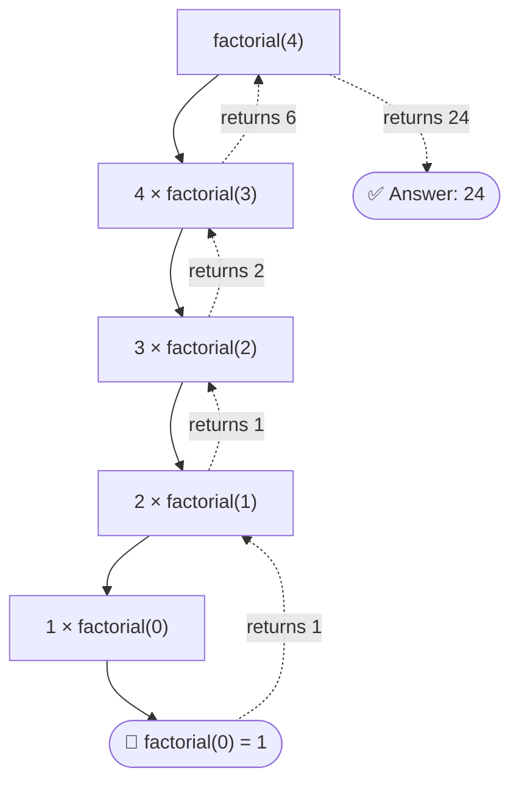
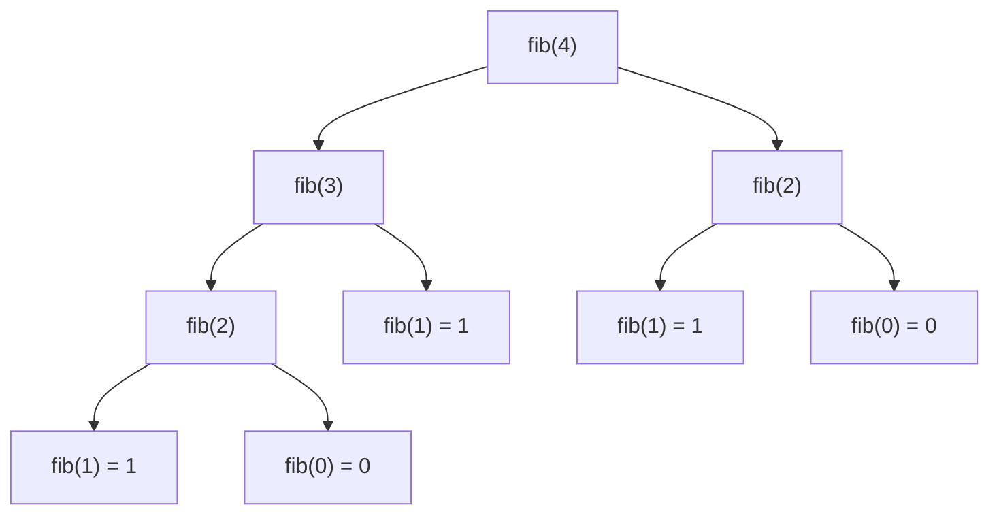

<div align="center">
# 🔁 Recursion in Real Life
 
### *To understand recursion, you must first understand recursion.*
 


 
**An interactive article inspired by the *Discrete Structures* course on [Saylor Academy](https://learn.saylor.org/)**
 
</div>
---
 
## 📑 Table of Contents
 
- [What is Recursion?](#-what-is-recursion)
- [The Two Golden Rules](#-the-two-golden-rules)
- [Recursion in Real Life](#-recursion-in-real-life)
- [The Math Behind It](#-the-math-behind-it)
- [Visualizing Recursion](#-visualizing-recursion)
- [Code It Yourself](#-code-it-yourself)
- [Quiz Time](#-quiz-time)
- [Key Takeaways](#-key-takeaways)
- [Further Reading](#-further-reading)
---
 
## 🧠 What is Recursion?
 
In **discrete structures**, a **recursive definition** describes something in terms of *smaller versions of itself*. Instead of listing every step, you say:
 
> "Solve a tiny case directly, and for everything else, reduce it to a smaller problem of the same kind."
 
Recursion shows up in:
 
| Area | Where you see it |
|------|------------------|
| 🔢 Mathematics | Factorials, Fibonacci numbers, sequences |
| 🌳 Data structures | Trees, linked lists, graphs |
| 💻 Algorithms | Binary search, merge sort, Tower of Hanoi |
| 🌍 Everyday life | Nesting dolls, mirrors, folders, family trees |
 
---
 
## 🏆 The Two Golden Rules
 
Every correct recursive definition needs **both**:
 
1. **🛑 Base case**: the simplest situation, answered directly. This is where recursion stops.
2. **🔄 Recursive case**: the rule that breaks a big problem into a smaller copy of the same problem.
> ⚠️ **No base case = infinite recursion.** Like standing between two mirrors, it never ends.
 
---
 
## 🌍 Recursion in Real Life
 
*Click each example to expand it* 👇
 
<details>
<summary><b>🪆 1. Russian Nesting Dolls (Matryoshka)</b></summary>
<br>
**Task:** Find the smallest doll.
 
- **Base case:** If the doll is solid (nothing inside), you found it. ✅
- **Recursive case:** Otherwise, open the doll and repeat the task on the doll inside.
```
open(doll):
    if doll has nothing inside: return doll
    else: return open(doll inside)
```
 
</details>
<details>
<summary><b>📁 2. Folders on Your Computer</b></summary>
<br>
A folder contains files **and other folders**, which contain files and other folders, and so on.
 
**Task:** Count all files in a folder.
 
- **Base case:** A folder with no subfolders: just count its files.
- **Recursive case:** Count the files in this folder **plus** the files inside each subfolder.
This is exactly how search tools and disk-usage analyzers work.
 
</details>
<details>
<summary><b>🪞 3. Two Mirrors Facing Each Other</b></summary>
<br>
Each mirror reflects an image that contains a reflection of the first mirror, which contains a reflection of the second, and so on. It's recursion **without a base case** (until the light fades or your eyes give up 😄).
 
The same idea appears in the **Droste effect**, where a picture contains a smaller copy of itself.
 
</details>
<details>
<summary><b>👨‍👩‍👧 4. Family Trees</b></summary>
<br>
**"Who are your ancestors?"**
 
- **Base case:** A person with no known parents has no further ancestors.
- **Recursive case:** Your ancestors are your parents **plus all of your parents' ancestors**.
</details>
<details>
<summary><b>🌿 5. Ferns, Trees, and Snowflakes (Fractals)</b></summary>
<br>
A fern leaf is made of smaller leaflets that look like the whole leaf. A tree branch splits into smaller branches that split again. Nature builds complex shapes by repeating a simple rule at smaller scales.
 
</details>
<details>
<summary><b>📖 6. Looking Up a Word in a Dictionary (Binary Search)</b></summary>
<br>
1. Open the dictionary in the middle.
2. If your word comes earlier, search the **left half**. If later, search the **right half**.
3. Repeat on the smaller half.
- **Base case:** You land on the word (or the section is empty).
- **Recursive case:** Search the half that remains.
Each step cuts the problem in half, so even a million words takes only about 20 steps.
 
</details>
<details>
<summary><b>🗼 7. Tower of Hanoi</b></summary>
<br>
Move *n* disks from peg A to peg C, never placing a larger disk on a smaller one.
 
- **Base case:** 1 disk, so just move it.
- **Recursive case:** Move *n − 1* disks to the spare peg, move the biggest disk, then move the *n − 1* disks on top of it.
</details>
---
 
## 📐 The Math Behind It
 
### Recursively defined functions
 
**Factorial**
 
$$
n! =
\begin{cases}
1 & \text{if } n = 0 \quad \text{(base case)} \\
n \cdot (n-1)! & \text{if } n > 0 \quad \text{(recursive case)}
\end{cases}
$$
 
**Fibonacci sequence**
 
$$
F(n) =
\begin{cases}
0 & \text{if } n = 0 \\
1 & \text{if } n = 1 \\
F(n-1) + F(n-2) & \text{if } n \ge 2
\end{cases}
$$
 
### Recurrence relations
 
A **recurrence relation** defines a sequence using its earlier terms. For Tower of Hanoi, the number of moves $T(n)$ satisfies:
 
$$
T(1) = 1, \qquad T(n) = 2\,T(n-1) + 1
$$
 
Solving it gives:
 
$$
T(n) = 2^n - 1
$$
 
<details>
<summary><b>🔍 Click to see the first few values</b></summary>
<br>
| Disks (n) | Moves T(n) |
|:---------:|:----------:|
| 1 | 1 |
| 2 | 3 |
| 3 | 7 |
| 4 | 15 |
| 5 | 31 |
| 10 | 1,023 |
| 64 | 18,446,744,073,709,551,615 |
 
</details>
### 🧩 Link to induction
 
Recursion and **mathematical induction** are two sides of the same coin:
 
| Induction | Recursion |
|-----------|-----------|
| Prove the **base case** | Define the **base case** |
| Assume true for *k*, prove for *k + 1* | Build the answer for *n* from the answer for *n − 1* |
 
That's why induction is the standard tool for proving that a recursive algorithm is correct.
 
---
 
## 👀 Visualizing Recursion
 
### Call stack for `factorial(4)`
 

 
### Recursion tree for `fib(4)`
 

 
> 💡 Notice that `fib(2)` is computed **twice**. For large *n* this repeated work explodes, which is why techniques like **memoization** exist.
 
---
 
## 💻 Code It Yourself
 
### Factorial
 
```python
def factorial(n):
    if n == 0:              # 🛑 base case
        return 1
    return n * factorial(n - 1)   # 🔄 recursive case
 
print(factorial(5))  # 120
```
 
### Fibonacci
 
```python
def fib(n):
    if n <= 1:              # 🛑 base cases: fib(0)=0, fib(1)=1
        return n
    return fib(n - 1) + fib(n - 2)   # 🔄 recursive case
 
print([fib(i) for i in range(10)])  # [0, 1, 1, 2, 3, 5, 8, 13, 21, 34]
```
 
### Tower of Hanoi
 
```python
def hanoi(n, source, target, spare):
    if n == 1:              # 🛑 base case
        print(f"Move disk 1 from {source} to {target}")
        return
    hanoi(n - 1, source, spare, target)                 # 🔄 move n-1 out of the way
    print(f"Move disk {n} from {source} to {target}")   # move the biggest disk
    hanoi(n - 1, spare, target, source)                 # 🔄 move n-1 on top
 
hanoi(3, "A", "C", "B")
```
 
<details>
<summary><b>▶️ See the output for <code>hanoi(3, "A", "C", "B")</code></b></summary>
<br>
```
Move disk 1 from A to C
Move disk 2 from A to B
Move disk 1 from C to B
Move disk 3 from A to C
Move disk 1 from B to A
Move disk 2 from B to C
Move disk 1 from A to C
```
 
7 moves, matching 2³ − 1 = 7 ✅
 
</details>
### 🔬 Watch it run
 
Paste any of the snippets above into [Python Tutor](https://pythontutor.com/) to step through each call and see the stack grow and shrink.
 
---
 
## 🎯 Quiz Time
 
*Think first, then click to reveal the answer.*
 
<details>
<summary><b>Q1.</b> What happens if a recursive function has no base case?</summary>
<br>
✅ **It never stops.** It keeps calling itself until the program runs out of memory (a *stack overflow*).
 
</details>
<details>
<summary><b>Q2.</b> What is <code>factorial(3)</code>?</summary>
<br>
✅ **6**, because 3 × 2 × 1 × (base case 1) = 6.
 
</details>
<details>
<summary><b>Q3.</b> Which of these is a <i>recursive case</i> for the sum of the first n numbers?</summary>
<br>
- A) `sum(n) = 0`
- B) `sum(n) = n + sum(n - 1)`
- C) `sum(n) = n × n`
✅ **B.** It reduces the problem to a smaller one of the same kind. (A would be the base case for n = 0.)
 
</details>
<details>
<summary><b>Q4.</b> How many moves does Tower of Hanoi need for 5 disks?</summary>
<br>
✅ **31**, since 2⁵ − 1 = 31.
 
</details>
<details>
<summary><b>Q5.</b> Name one example of recursion from your own life.</summary>
<br>
🎉 There's no single right answer. Folders, family trees, nested comments on a post, and org charts all count. Share yours in the discussion!
 
</details>
---
 
## ✅ Key Takeaways
 
- [x] Recursion solves a problem by reducing it to **smaller copies of itself**
- [x] Every recursive definition needs a **base case** and a **recursive case**
- [x] Recursion is everywhere: nature, computers, and daily life
- [x] Recursive functions are described by **recurrence relations**
- [x] **Induction** is the tool for proving recursive definitions correct
- [ ] Try writing your own recursive function (your turn!)
---
 
## 📚 Further Reading
 
- 🎓 [Saylor Academy: Discrete Structures course](https://learn.saylor.org/)
- 🐍 [Python Tutor: visualize code execution](https://pythontutor.com/)
- 📖 Look up: *recursive definitions*, *recurrence relations*, *structural induction*, *memoization*
---
 
## 🤝 Contributing
 
Found a typo or have a better real-life example? Open an issue or submit a pull request!
 
1. 🍴 Fork this repository
2. 🌿 Create a branch: `git checkout -b my-example`
3. 💾 Commit your changes
4. 🚀 Open a pull request
---
 
<div align="center">
**Made with ❤️ while learning Discrete Structures**
 
*If this helped you, drop a ⭐ on the repo!*
 
*(Remember: to understand recursion, see [Recursion in Real Life](#-recursion-in-real-life) 😉)*
 
</div>
